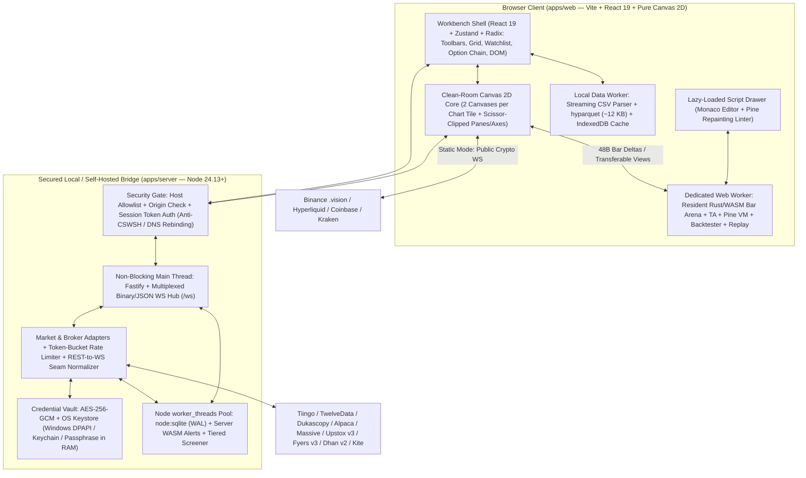

# OpenView — Master Implementation Plan (v2 · Production-Hardened Blueprint)

> **Target Markets:** Crypto (`Spot` · `Perps` · `L2`) · Forex, Precious Metals & Energy (`EUR/USD`, `XAU/USD`, `XAG/USD`, `USOIL`) · US Equities (`NYSE` / `NASDAQ`) · Indian NSE, BSE & MCX (`NIFTY`, `BANKNIFTY`, Cash Equities, F&O, Commodities)
> **Delivery Target:** Web-Only Financial Terminal — **Full Local / Self-Hosted Mode** (Browser + Secured Node 24 Bridge) + **Zero-Backend Static Mode** (Direct Public Crypto WS + Local CSV/Parquet)
> **Workspace:** `E:\coding\oss trading view`
> **License:** 100% Clean-Room MIT / Apache-2.0 (zero proprietary TradingView code, zero connections to TradingView private endpoints, zero unauthorized data redistribution)

---

## 1. System Architecture & Non-Negotiable Engineering Foundations

### 1.1 Dual-Mode Web Topology (Zero CORS Failures, Zero Event-Loop Stalls, Zero Secret Leaks)

Running a web-only terminal across **Crypto, Forex/Gold, US Stocks, and Indian NSE/MCX** requires separating browser-accessible public streams from broker/API streams that enforce non-CORS REST headers, OAuth secret exchanges, binary Protobuf frames, or custom `Authorization` headers.



1. **Full Local / Self-Hosted Mode (`npm run dev` or single Docker container):**
   Launches `apps/web` (`http://127.0.0.1:5173`) + `apps/server` (`http://127.0.0.1:4001`) concurrently. Unlocks **all 4 markets**, broker OAuth flows, binary Upstox v3 / Kite / Dhan WebSocket decoding, continuous futures stitching, local SQLite historical bar caching, 24/7 background alerts, and multi-market screening.
2. **Zero-Backend Static Mode (GitHub Pages / Cloudflare Pages / Vercel):**
   When `apps/server` is unreachable, `DatafeedRegistry` cleanly disables Bridge-only providers (displaying an honest `Bridge Offline — Static Mode` badge) and runs 100% in-browser using public Crypto WebSockets (`wss://data-stream.binance.vision/ws` with `< 2.5s` auto-failover to Hyperliquid/Coinbase/Kraken), drag-and-drop CSV/Parquet files (`hyparquet`), full indicators/drawings/replay/backtesting, and `IndexedDB` persistence.

---

### 1.2 Threading & Bundle Budget Rules (Fast Boot, Zero Jitter)

- **Strict Main-Thread Isolation (Browser):** React (`Zustand`) never receives raw mouse-move coordinates or unthrottled market ticks. Canvas 2D renders independently via a coalesced `requestAnimationFrame` dirty-bitmask loop (`Cursor | Light | Full`). React UI panels (Watchlist, Data Window, Option Chain, DOM summary) receive rAF-throttled snapshots capped at `<= 20 Hz`.
- **Strict Event-Loop Isolation (Node 24 Server):** Node's built-in `node:sqlite` (`DatabaseSync`) is **synchronous and blocking**. `DatabaseSync` is **forbidden on the main Fastify/`ws` thread**. All SQLite reads/writes (`PRAGMA journal_mode = WAL; PRAGMA synchronous = NORMAL; PRAGMA busy_timeout = 5000;`), background Screener scans, and server-side WASM Alert evaluations run inside a dedicated **`node:worker_threads` worker** (`db-compute.worker.ts`) so WebSocket tick/depth forwarding never stalls.
- **Strict Initial Bundle Budget (`< 200 KB` gzipped JS):**
  - **No `DuckDB-WASM` (`~35 MB`):** Local Parquet & CSV ingestion uses a lightweight streaming Worker CSV parser + **`hyparquet`** (`~12 KB` zero-dependency JS Parquet reader).
  - **Lazy-Loaded Heavy Panels:** `Monaco Editor` (`~6 MB`), `StrategyTester` analytics charts, and `Screener` load via dynamic `import()` strictly when the user opens those drawers.

---

### 1.3 P0 Security Architecture (Mandatory Before Any Broker Key Touches Disk)

Because `apps/server` holds personal market-data keys and optional live brokerage tokens, it enforces four mandatory security controls from Phase 0:

1. **Anti-CSWSH (Cross-Site WebSocket Hijacking) & Anti-DNS-Rebinding Gate:**
   Browsers do **not** run CORS preflights on `new WebSocket("ws://localhost:4001/ws")`. Without protection, any malicious tab open in Chrome could connect to `localhost:4001` and trigger broker actions.
   - `apps/server` binds strictly to `127.0.0.1` by default (configurable explicitly for Docker/VPS).
   - Every HTTP request and `/ws` `upgrade` handshake validates **both** the `Host` header against an explicit allowlist and the `Origin` header (`http://127.0.0.1:5173`, `http://localhost:5173`, or configured production origin).
   - On startup/login, `apps/server` issues a 256-bit cryptographic session token (`HttpOnly; SameSite=Strict` cookie + CSRF header / one-time WS ticket). Unauthenticated WebSocket connections are rejected with `HTTP 401` before socket upgrade.
2. **Hardware/OS-Backed Credential Vault (Zero `.env` Master-Key Theater):**
   - Provider secrets and OAuth tokens are encrypted per-record using **`AES-256-GCM`** with unique 96-bit nonces and provider-bound `AAD`.
   - **Master Key Sealing:** Never store a plaintext master key next to the SQLite file.
     - **Windows (`win32`):** Master key is sealed/unsealed automatically via **Windows DPAPI (`CurrentUser` scope)** using built-in `.NET` `System.Security.Cryptography.ProtectedData` invoked via `powershell.exe -NoProfile -NonInteractive` over `stdin` (zero native C++/MSVC `node-gyp` addons, never passed on CLI args) so only the logged-in OS user session can decrypt it into Node RAM.
     - **macOS / Linux / Self-Hosted Docker:** Uses OS Keychain / `libsecret` when available, or prompts once in the UI for a Vault Unlock Passphrase (`Argon2id` / `scrypt` key derivation) held exclusively in process memory.
3. **Post-Resolution Webhook SSRF Protection:**
   Outbound alert webhooks use a custom `undici` / `http.Agent` `lookup` hook that resolves DNS **once** and blocks connections if the resolved IPv4/IPv6 falls inside loopback (`127.0.0.0/8`, `::1`), private RFC1918 (`10.0.0.0/8`, `172.16.0.0/12`, `192.168.0.0/16`), link-local / cloud metadata (`169.254.0.0/16`, `fe80::/10`), or CGNAT (`100.64.0.0/10`) — preventing DNS-rebinding TOCTOU bypasses.
4. **Live Execution Safety Airlock:**
   Live broker plugins remain disabled unless explicitly toggled from `PAPER` to `LIVE` with a two-step confirmation modal, per-order notional/quantity hard caps, and a persistent high-contrast `LIVE TRADING` top-bar border.

---

### 1.4 Verified Local Windows Toolchain & Space-Safe Build Pipeline

Verified against the target machine (`Windows`, `Node v24.13.0`, `npm 11.6.2`, `rustc 1.100.0`, `cargo 1.100.0` on `x86_64-pc-windows-msvc`, workspace path `E:\coding\oss trading view`):

- **Missing WASM Target & Bindgen Bootstrap (Handled Automatically in Phase 0):**
  The host currently has `x86_64-pc-windows-msvc` installed without `wasm32-unknown-unknown`, `wasm-pack`, or `wasm-bindgen`, and `cl.exe`/`link.exe` are not on default `PATH`.
  - Phase 0 includes `scripts/bootstrap-wasm.mjs` which runs `rustup target add wasm32-unknown-unknown` (pure Rust stdlib target — requires **zero** C/MSVC linker for `wasm32-unknown-unknown` crates!) and downloads the exact matching prebuilt `wasm-bindgen-cli` Windows binary into `.tools/bin/` (pinned with exact `wasm-bindgen = "=0.2.xx"` in `Cargo.toml` so CLI and crate patch versions can never drift, avoiding compiling 200+ native crates on Windows).
- **100% Space-Safe Build Scripts (`oss trading view`):**
  Because `E:\coding\oss trading view` contains spaces, **no** `package.json` script may interpolate unquoted `$PWD` or shell paths. All build/WASM/test orchestration runs through Node `.mjs` scripts (`scripts/build-wasm.mjs`, `scripts/dev.mjs`) using `child_process.execFileSync(executable, argsArray, { cwd })`.

---

## 2. Four-Market Data, Microstructure & Regulatory Matrix (2026 Reality-Checked)

Every chart displays an explicit **Feed & Volume Integrity Badge** in the top bar:
- `● LIVE · FULL VOL` (Exchange Spot/Perps/Futures or Paid SIP)
- `● LIVE · SUBSET VOL` (e.g., Alpaca Free IEX `~2.5%` US Equity volume)
- `◐ LIVE · QUOTE / ZERO VOL` (Spot Indices `NIFTY`/`BANKNIFTY`, OTC FX Quote/Tick-Vol, or Oracle feeds)
- `◑ DELAYED / EOD` (Historical/Bhavcopy/Archive baseline)
- `◷ REPLAY` (Master-Clock Historical Simulation)

### 2.1 Truthful Market-by-Market Provider Architecture

| Market | Zero-Key Day-1 Baseline (Instant Boot) | Free-Account 1-Click Live Connectors (`$0` / `₹0` API Fee) | Paid / Pro BYOK Connectors (Optional) | Critical Engine & Regulatory Rules |
| :--- | :--- | :--- | :--- | :--- |
| **1. Crypto** (`BTCUSDT`, `ETHUSDT`, `SOLUSDT`) | **Live Full-Vol!** Binance Public Data (`data-api.binance.vision` + `wss://data-stream.binance.vision/ws`) with `< 2.5s` segment-matched failover (**Spot -> Coinbase/Kraken Spot**; **Perps -> Hyperliquid/Bybit Perps**, defeating US `451` & ISP DNS blocks without mixing spot/perp funding basis) | Same public feeds (Spot + Hyperliquid/Bybit Perps + `aggTrade` + L2 Depth) | User API keys for Binance / Bybit / Coinbase / Hyperliquid account sync & execution | `24x7` UTC sessions; dynamic `pricescale` up to `1e8`; proactive `23h50m` socket rollover before Binance 24h cap; outbound WS limiter `<= 4 msg/s` |
| **2. Forex, Gold & Oil** (`EURUSD`, `XAUUSD`, `XAGUSD`, `USOIL`) | **Archive + Proxy Baseline:** **Dukascopy `.bi5`** multi-year M1/tick archive via Bridge (capped at last completed UTC hour, graceful `404` on active hour/weekends) + zero-key 24/7 Gold proxy (`BINANCE:PAXGUSDT`) | **Tiingo FX** (`wss://api.tiingo.com/fx` free live top-of-book WS + free 1m REST history that **fills Dukascopy's current-hour gap**, with local SQLite `1m -> 5m/15m/1H/4H/1D` rollup to stay far inside Tiingo's `50 req/hr` free quota!) + **Twelve Data** (free 800 REST req/day) — **100% legal & accessible globally including India** | **OANDA v20** *(tagged Global / Non-India due to RBI FEMA Alert List)*; **Pyth Pro / Hermes v2** (`Bearer` key via Bridge SSE, flagged `hasVolume: false`) | **Session anchored to `17:00 America/New_York` (NY Close)** (`Sun 17:00 ET – Fri 17:00 ET`, auto-shifting `21:00 UTC` EDT / `22:00 UTC` EST so `1D`/`4H` bars never drift!); quote changes labeled `Tick Vol` |
| **3. US Stocks** (`AAPL`, `NVDA`, `SPY`, `QQQ`, `TSLA`) | **EOD / Delayed Baseline:** Cached Stooq / Tiingo EOD + bundled S&P 500 / NASDAQ 100 symbol master | **Alpaca v2 Free (`IEX`)** (live WS + REST history; badged `IEX ~2.5% Vol · 08:00–17:00 ET`) + **Finnhub Free WS** (live trade ticks **auto-paired with Alpaca/Tiingo REST** since Finnhub paywalled REST `stock/candle`!) | **Alpaca Algo Trader Plus (`SIP` 100% vol, `04:00–20:00 ET`)**, **Massive** (formerly `Polygon.io`, `api.massive.com`) | `America/New_York` DST-aware (`Pre 04:00–09:30`, `RTH 09:30–16:00`, `Post 16:00–20:00`, NYSE holiday & `13:00 ET` half-day calendar); Reg NMS ticks (`$0.01` `>= $1`, `$0.0001` `< $1`) |
| **4. Indian NSE, BSE & MCX** (`NIFTY`, `BANKNIFTY`, `RELIANCE`, F&O, `GOLD`) | **EOD Baseline:** Official NSE/BSE public **UDiFF Bhavcopy** loader + daily Instrument Master (zero brittle `nseindia.com` Akamai scraping!) | **Upstox API v3** (`₹0` fee: live binary Protobuf `Market Data Feed V3` + `Historical Candle V3` + `Option Greek V3` — *never discontinued v2!*) & **Fyers API v3** (`₹0` fee: live binary WS + multi-year free `1m` intraday history!) | **DhanHQ v2** (`₹0` execution; `₹499/mo + GST` Data API for live WS, 20-lvl depth & expired options) · **Zerodha Kite** (`₹0` Personal execution-only; `₹500/mo` Connect for live WS + history) | **`Asia/Kolkata` (`UTC+05:30`) `09:15` session-anchored candles**; **Dynamic per-scrip NSE tick bands (`₹0.01` to `₹5.00`)**; Spot Index `hasVolume: false` + Futures Volume Proxy; **SEBI Apr 2026 Static-IP execution compliance** |

---

### 2.2 Exact Indian NSE, BSE & MCX Microstructure Rules (Zero-Mistake Specification)

1. **Dynamic Per-Instrument Tick & Lot Sizes (2025–2026 NSE Price-Band Framework):**
   NSE abolished uniform `₹0.05` ticks. Cash & Stock Futures tick sizes now scale dynamically by price band (`< ₹250` -> `₹0.01`, `₹250–₹1,000` -> `₹0.05`, `> ₹1,000–₹5,000` -> `₹0.10`, `> ₹5,000–₹10,000` -> `₹0.50`, `> ₹10,000–₹20,000` -> `₹1.00`, `> ₹20,000` -> `₹5.00`; Index Futures: `0–15k` -> `₹0.05`, `15k–30k` -> `₹0.10`, `> 30k` -> `₹0.20`).
   - **Rule:** `PriceScale`, `OrderTicket`, `DOMLadder`, and `Footprint` **never hardcode `0.05`**. Every NSE/BSE/MCX symbol reads exact `tickSize` and `lotSize` from the daily Broker Instrument Master CSV/JSON synced by `apps/server`.
2. **Session-Anchored Intraday Buckets + REST Seam Normalization (`09:15–15:30 IST`):**
   - Regular NSE session is `375 minutes` (`09:15–15:30 IST`, Pre-open `09:00–09:15`).
   - Intraday bars anchor to `sessionOpen` (`09:15`): e.g., `1H` produces `09:15–10:15`, `10:15–11:15`, `11:15–12:15`, `12:15–13:15`, `13:15–14:15`, `14:15–15:15`, and a `15:15–15:30` (15m) closing stub; `4H` produces `09:15–13:15` + `13:15–15:30`.
   - **Hard Session-Close Invariant:** All intraday buckets (`< 1D`) force-close at `sessionClose` (`15:30 IST`) so Friday's `15:15–15:30` stub never bleeds into Monday's `09:15` candle.
   - **REST-to-Live Seam Normalizer:** Because some broker REST APIs return clock-aligned `60m` bars (`09:15–10:00`, `10:00–11:00`) while TradingView uses `09:15–10:15`, `apps/server` builds `1H`/`2H`/`4H` bars deterministically from cached `1m`/`5m` history when needed so historical and live WS candles never overlap or duplicate at `10:00`.
3. **Special Sessions & MCX US-DST Coupling:**
   - `SessionCalendar` includes a `specialSessions` override list so **Diwali Muhurat Trading** (1-hour evening session) and **Union Budget / NSE Disaster-Recovery Saturday live sessions** render normally instead of being dropped by weekday filters.
   - **MCX Commodity Hours** (`09:00–23:30 IST` vs `09:00–23:55 IST`) compute evening close dynamically from **US Daylight Saving Time (`America/New_York`)**, which governs COMEX/NYMEX reference hours.
4. **Zero-Volume Spot Indices + 1-Click Futures Volume Proxy:**
   - `NSE:NIFTY`, `NSE:BANKNIFTY`, `NSE:FINNIFTY`, and `BSE:SENSEX` spot indices have **`volume = 0`** and no L2 book (`hasVolume: false, supportsOrderbook: false`).
   - Volume-based studies (`VWAP`, `OBV`, `MFI`, `CVD`, `SVP/VRVP`) check `hasVolume` to avoid `0 / 0 = NaN` and offer a **1-click `"Use Front-Month Futures Volume (NIFTY1!)"` toggle** — letting Indian index traders run institutional Session VWAP and Volume Profile directly on their Spot Index chart.
5. **Continuous Futures Stitcher (`1!` / `2!`) & SEBI Option Expiry Rules:**
   - `packages/datafeed-sdk` synthesizes continuous contracts (`NSE:NIFTY1!`, `NSE:BANKNIFTY1!`, `MCX:GOLD1!`, `MCX:CRUDEOIL1!`) across monthly expiry rollovers with user-selectable **`None`**, **`Difference (Panama additive)`**, or **`Ratio`** back-adjustment.
   - Option Chain UI reflects current SEBI index derivative rules (weekly expiries solely on benchmark `NSE:NIFTY` and `BSE:SENSEX`; monthly expiries on `BANKNIFTY`, `FINNIFTY`, `MIDCPNIFTY`, and stock options).
6. **SEBI Retail Algo Framework Compliance (`CIR/2025/0000013`, Mandatory since April 1, 2026):**
   - Read-only market data works anywhere, **but live NSE/MCX API order placement** requires a broker-whitelisted **Static IPv4 address**, daily 2FA login, Market Price Protection (MPP), and `<= 10 orders/sec`. Phase 8's NSE Execution Adapter enforces pre-flight public-IP verification against the user's configured Static IP, automatic MPP limit-buffer protection on market orders, and a strict `8 orders/sec` client token bucket.

---

### 2.3 Corporate Actions & Historical Bar Cache Integrity

Caching adjusted bars blindly in SQLite/IndexedDB creates fake `-50%` or `-90%` crash cliffs the morning a stock splits or issues bonus shares (`NVDA` 10:1 split, `NSE:RELIANCE` 1:1 bonus).
- **Rule:** SQLite stores **raw unadjusted bars** when available + a `corporate_actions (symbol, ex_date, factor, type)` table, **PLUS** an automatic **Tail-Overlap Reconciliation Check**: whenever fetching latest bars for a cached symbol, `apps/server` overlaps the last 5 cached daily closes; if any historical close diverges beyond `2 * tickSize`, the stale symbol cache is automatically invalidated and backfilled cleanly.

---

## 3. Monorepo Structure & Strict Dependency DAG

```text
E:\coding\oss trading view\
├── package.json                       # npm workspaces root + space-safe Node .mjs orchestration scripts
├── tsconfig.base.json                 # Strict TS project references (noUncheckedIndexedAccess, exactOptionalPropertyTypes)
├── config/
│   ├── fee-schedules.json             # Editable brokerage/tax presets (NSE STT/GST/Stamp/SEBI/DP, US SEC/TAF, Crypto, FX)
│   └── market-calendars.json          # Exchange holidays, half-days & special sessions (NSE Muhurat, NYSE early close)
├── scripts/
│   ├── bootstrap-wasm.mjs             # Space-safe rustup wasm32 check + prebuilt wasm-bindgen-cli installer
│   ├── build-wasm.mjs                 # Space-safe cargo -> wasm-bindgen -> packages/script-runtime pipeline
│   └── dev.mjs                        # Concurrent Web + Bridge + WASM watcher
├── packages/
│   ├── protocol/                      # Shared types & binary/JSON codecs: Bar, SymbolInfo, WS Frames, WorkspaceSnapshot
│   ├── chart-engine/                  # Pure TS Canvas 2D Engine (ZERO React, ZERO network):
│   │   ├── src/canvas/                #   TileCanvasPair (base+top), ScissorViewport, HiDPI scope, DirtyScheduler (rAF)
│   │   ├── src/model/                 #   ChartModel, PaneLayoutSolver, TimeScale, SymlogPriceScale, MipmapPlotList, SessionCalendar
│   │   ├── src/views/                 #   Frustum culling, Mipmap LOD selector, hierarchical tick generators
│   │   ├── src/renderers/             #   Candles, Hollow, Bars, Line, Area, Baseline, Histogram, Grid, Crosshair, AxisGutter
│   │   ├── src/input/                 #   Pointer/Wheel/Touch state machine, kinetic pan inertia, axis drag-to-scale
│   │   └── src/api/                   #   Imperative IChartEngine facade
│   ├── drawings/                      # Vector Drawing Engine (IDrawingTool, analytical hit-testing, Magnet, UndoModel, ObjectTree)
│   ├── chart-types/                   # 1m-sourced Renko/Range/Kagi/P&F/LineBreak, Dual-Mode Footprint, SVP/VRVP/FRVP, TPO, Spreads
│   ├── datafeed-sdk/                  # IDatafeed, DatafeedRegistry, Crypto direct clients, BridgeClient, ContinuousFutures, CSV/hyparquet
│   ├── replay-engine/                 # Unified Master Replay Clock + Zero-Lookahead Multi-TF forming-bar synthesizer
│   ├── broker-sdk/                    # IBrokerAdapter, Live/Replay Paper Matching Engine, FeeCalculator, On-Chart Order Primitives
│   └── script-runtime/                # Dedicated Web Worker managing resident WASM Bar Arena, TS Indicator SDK & Pine VM bridge
├── crates/
│   └── openview-wasm/                 # Rust workspace compiled to wasm32-unknown-unknown
│       ├── arena/                     #   Zero-copy resident OHLCV & output plot memory arena (48-byte incremental bar deltas)
│       ├── ta/                        #   100+ indicators (Wilder RMA, ddof=0 BB, Session/Proxy VWAP, SuperTrend, Ichimoku)
│       ├── pine-lang/                 #   Clean-room Pine v5/v6 Lexer, Parser, Qualifier Checker, Repainting Linter & Arena-Rollback VM
│       └── backtester/                #   Deterministic Strategy Emulator, Gap-Open Slippage, Intrabar 1m Magnifier & Metrics
├── apps/
│   ├── web/                           # React 19 + Tailwind v4 + Radix UI + Zustand Workbench SPA (< 200 KB initial gzipped JS)
│   │   ├── src/workbench/             #   TopBar, LeftDrawToolbar, MultiChartGrid (up to 4x2), WorkspaceSyncBus, RightSidebar
│   │   ├── src/modals/                #   SymbolSearch (Ctrl+K), IndicatorPicker, ProviderVaultModal, ChartSettings, AlertModal
│   │   ├── src/panels/                #   Watchlist, ObjectTree, DataWindow, OptionChainPanel, DOMLadder, OrderTicket
│   │   ├── src/lazy/                  #   Dynamic-imported MonacoScriptDrawer, StrategyTesterDrawer, MultiMarketScreenerDrawer
│   │   └── src/storage/               #   IndexedDB offline workspace/drawing/bar store + Bridge sync client
│   └── server/                        # Node 24 + Fastify + ws Secured Local / Self-Hosted Bridge
│       ├── src/security/              #   Host/Origin/Token CSWSH Guard, DPAPI/Passphrase AES-256-GCM Vault, SSRF-Safe Fetch
│       ├── src/providers/             #   Binance, Hyperliquid, Coinbase, Tiingo, TwelveData, Dukascopy, OANDA, Alpaca, Massive,
│       │                              #   Finnhub, Upstox v3 (Protobuf), Fyers v3, DhanHQ v2, Zerodha Kite, NSE UDiFF Bhavcopy
│       ├── src/ws/                    #   Multiplexed WS Hub + Token-Bucket Upstream Rate Limiter + Seam Normalizer
│       └── src/workers/               #   db-compute.worker.ts: node:sqlite (WAL) + Server WASM Alerts + Tiered Screener Matrix
└── tests/
    └── e2e/                           # Playwright 1x/1.25x/1.5x/2x HiDPI visual, security & multi-market workflow tests
```

---

## 4. Deep Technical Specifications (Eliminating Every Hidden Engineering Trap)

### 4.1 Clean-Room Canvas 2D Engine (`packages/chart-engine`)

1. **Two Canvases Per Chart Tile + Scissor-Clipped Sub-Viewports (Zero VRAM Bloat):**
   - Spawning separate `<canvas>` elements per pane and per axis across a `4x2` multi-pane layout creates `60–100+` GPU textures (`> 500 MB` VRAM at 4K).
   - Instead, **each Chart Tile owns exactly 2 canvases** (`baseCanvas` for static series/drawings/axes, `topCanvas` for 120 FPS crosshair/active drag handles/axis badges — at most `16` canvases total in an 8-chart grid!).
   - `PaneLayoutSolver` divides the tile mathematically into `PaneRect[]`, `LeftAxisRect`, `RightAxisRect`, and `TimeAxisRect`, isolating each region via `ctx.save(); ctx.beginPath(); ctx.rect(x, y, w, h); ctx.clip();`. Dragging pane dividers has zero DOM resize jitter, and exporting a crisp PNG snapshot is a single `toBlob()` call.
2. **HiDPI Physical Pixel Crispness:**
   - Bound via `ResizeObserver` `devicePixelContentBoxSize` (fallback `Math.round(cssPx * dpr)`).
   - Odd physical stroke widths (`1px`) snap to `Math.floor(px) + 0.5`; candle body width parity matches wick width (`(bodyPx & 1) === (wickPx & 1)`) so wicks sit dead-center inside every candle at 100%, 125%, 150%, and 200% Windows scaling.
3. **`MipmapPlotList` (O(1) Prepend + Flicker-Free Zoomed-Out Rendering):**
   - Base level `L0` stores `4,096`-bar `Float64Array` SoA chunks (`time, open, high, low, close, volume`) with signed `startIndex` (O(1) left-scroll prepend) and integer `barIndex` primary keys (supporting duplicate timestamps in Renko/Range).
   - **Power-of-2 Index-Aligned Mipmap Pyramid (`L1=2x, L2=4x, L3=8x, L4=16x, L5=64x`):** Pre-aggregates fixed data-index pairs into `(firstOpen, maxHigh, minLow, lastClose, sumVolume)`. Unlike naive screen-pixel grouping (which flickers/shimmers on every 1px pan as column boundaries shift!), data-aligned mipmaps are **100% pan-invariant** and render `250,000` bars in `< 0.5ms` (`~2,000` bucket reads max).
4. **Pan-Invariant Symmetric Bi-Log (`symlog`) Price Scale:**
   - Never shift log scales by `visibleMin` (which warps vertical candle ratios and bends straight trendlines during horizontal panning!).
   - Uses a pan-invariant symmetric log transform anchored to a fixed per-series constant (never `visibleMin`):
     $$f(p) = \operatorname{sign}(p) \cdot \ln\!\left(1 + \frac{|p|}{C}\right), \quad C = \begin{cases} \max(\text{symbol.tickSize},\ 10^{-8}) & \text{if strictly positive instrument} \\ \text{linthresh}\ (\text{default } 100 \cdot \text{tickSize},\text{ configurable}) & \text{if zero-crossing spread/oscillator} \end{cases}$$
     Continuously differentiable across $p = 0$ without compressing spread ranges near zero, while preserving exact logarithmic percentage invariance for all positive instruments.

---

### 4.2 Zero-Copy WASM Arena & Honest Pine-Compatible Runtime (`crates/openview-wasm`)

1. **Resident WASM Memory Arena (Zero `postMessage` Clone Stalls):**
   - Never copy `250,000` bars across JS <-> Worker <-> WASM on live ticks.
   - `openview-wasm/arena` owns the resident OHLCV ring/chunk buffers inside the Worker. Live ticks send a **`48-byte` incremental delta** `(time, O, H, L, C, V)` into WASM; indicator/script outputs transfer only visible/updated slices back via transferable `ArrayBuffer` views (requiring **no** `Cross-Origin-Embedder-Policy` headers that would break broker OAuth popups).
2. **TradingView-Exact TA Numerical Parity:**
   - `ta.rsi`, `ta.atr`, `ta.adx`, `ta.supertrend`: Wilder's Smoothing (`RMA`, $\alpha = 1/N$, seeded by $N$-bar `SMA`).
   - `ta.bb`: Population standard deviation ($\text{ddof} = 0$).
   - `ta.vwap`: Resets on `SessionCalendar` session open (`09:15 IST`, `09:30 ET`, `17:00 ET` FX, `00:00 UTC` Crypto) and supports Futures Volume Proxy on Spot Indices.
3. **Exact Pine `request.security()` Semantics + Static Repainting Linter:**
   - Altering `request.security()` defaults to auto-shift by 1 HTF bar breaks every properly written community Pine script (`request.security(..., close[1], lookahead = barmerge.lookahead_on)` would suffer a 2-bar double lag!).
   - Our VM implements **100% faithful Pine v5/v6 `barmerge.gaps_off` + `barmerge.lookahead_off` semantics** AND pairs it with a **Compile-Time Repainting Linter** in Monaco that flags unguarded live HTF calls (`⚠️ Repainting Warning: unconfirmed HTF series fluctuates intra-bar; use expr[1] with lookahead_on for strict backtest/live parity`).
4. **Full Arena Checkpointing for Realtime Tick Rollback (`var` vs `varip`):**
   - At bar `N - 1` close, the VM snapshots **all four mutable planes**: (a) scalar series ring-buffer cursors, (b) per-call-site stateful `ta.*` slots, (c) `var` heap collections (`array`, `map`, UDT instances), and (d) active script drawing pools (`line`, `label`, `box`, `table`).
   - Every incoming intra-bar tick on bar `N` restores the `N - 1` checkpoint in microseconds while preserving the isolated `varip` arena, guaranteeing zero intra-bar state drift or duplicate `label.new` leaks.

---

### 4.3 Realistic Orderflow, Non-Time Charts & Spreads (`packages/chart-types`)

1. **Dual-Mode Volume Footprint (Honest Across All 4 Markets):**
   - **Mode A — Live Tick / Cumulative-Delta Footprint:**
     - *Crypto (`aggTrade`)*: Exact buyer- vs seller-initiated trade size per price row.
     - *Indian NSE Live Binary WS*: Because retail NSE feeds emit coalesced snapshots (`1–4 Hz`) where summing `LTQ` misses ~70% of volume, the adapter computes **`deltaVol = current.volume_traded_today - prev.volume_traded_today`** and classifies aggressor side via **Lee-Ready** (`LTP >= bestAsk` -> Ask/Buy, `LTP <= bestBid` -> Bid/Sell, else uptick/downtick rule) — ensuring exact volume conservation!
   - **Mode B — Intrabar `1m` Profile Footprint (Historical & Non-Tick Feeds):**
     - Because historical REST APIs on NSE/US/FX do not serve multi-day tick tapes, historical Footprint bars synthesize price-row buy/sell distributions from underlying `1m` candles (matching TradingView's historical Volume Footprint architecture) and display an explicit `1m Intrabar Profile` vs `Live Tick Delta` mode badge.
2. **1m-Sourced Non-Time Charts & Strategy Guardrails:**
   - **Renko, Range, Kagi, Point & Figure, and Line Break** always build deterministically from underlying `1m`/tick streams (never from arbitrary `1H`/`4H` OHLC bars that mutate brick history when switching intervals).
   - Opening Strategy Tester on Renko/Kagi displays a prominent **Synthetic Brick Fill Warning** explaining why synthetic brick opens inflate backtest win rates unless evaluated against real underlying ticks.
3. **Mathematically Valid Synthetic Spreads (`A / B`, `A - B`):**
   - Never compute `High(A / B) = High(A) / High(B)` (which frequently produces invalid inverted candles where `High < max(Open, Close)`!). Historical spread bars compute exact `Open` and `Close` from timestamp-aligned constituents (with configurable `inner-join` vs `ffill` for cross-market calendars like `NSE:NIFTY / BINANCE:BTCUSDT`) and clamp historical wicks to `max(O, C)` / `min(O, C)`, tracking true intrabar extremes on live synchronized ticks.

---

### 4.4 Backtester Realism & Tiered Screener Architecture

- **Realistic Strategy Backtester (`crates/openview-wasm/backtester`):**
  - **Gap-Open Fill Rule:** Stop and Limit orders breached by an overnight/weekend open gap (e.g., NSE `09:15` gap past a Stop-Loss) fill realistically at **`bar.open ± slippage`**, never at the impossible stop trigger price!
  - **Intrabar `1m` Bar Magnifier:** Resolves same-bar `SL` + `TP` ambiguity using cached/chunk-streamed `1m` bars before falling back to the `|O - H| < |O - L|` OHLC path heuristic.
  - **Externalized Fee & Tax Engine (`config/fee-schedules.json`):** Ships accurate, user-editable presets including 2025–2026 Indian charges (STT `0.02%` Futures sell / `0.1%` Options sell, uniform True-to-Label NSE/BSE transaction fees, buy-side Stamp Duty, SEBI turnover fees, `18%` GST, CNC DP charges), US SEC/TAF fees, FX spreads, and Crypto maker/taker bps.
- **Rate-Limit-Safe Tiered Screener (`apps/server/src/workers`):**
  - Never hammer retail broker APIs with `10,000` simultaneous historical requests.
  - Operates on curated, fast-warming **Screener Universes**: **Crypto All USDT** (single Binance `!miniTicker@arr` stream), **NSE NIFTY 50 / NIFTY 200 / F&O (~220 liquid scrips)** (warmed via Upstox 500-symbol batch Market Quote V3 + progressive SQLite bar cache), **US S&P 100 / NASDAQ 100** (Alpaca multi-symbol `/v2/stocks/bars` batching 100 tickers/call), and **Custom User Watchlists**.

---

## 5. Phased Execution Roadmap (Phases 0 to 8 — De-Risked & Gate-Verified)

Every phase concludes with a **strict automated verification gate**. No phase advances until all unit, numerical, security, and performance checks pass.

### Phase 0 — Workspace Scaffold, Space-Safe WASM Pipeline & Secured Bridge Foundation
**Deliverables:**
- Initialize git repository, `npm workspaces`, `tsconfig.base.json`, ESLint, Vitest, and Playwright inside `E:\coding\oss trading view`.
- Implement `scripts/bootstrap-wasm.mjs` & `scripts/build-wasm.mjs` (installs `wasm32-unknown-unknown` + local prebuilt `wasm-bindgen-cli`, compiles `crates/openview-wasm` cleanly with space-containing paths).
- Scaffold `apps/web` (Vite + React 19 + Tailwind v4), `packages/protocol`, and `apps/server` (Fastify + `ws` + `db-compute.worker.ts` running `node:sqlite` in `WAL` mode).
- Implement **P0 Security Layer** on Day 1: `Host` + `Origin` + Session-Token CSWSH gate on `/ws`, Windows DPAPI / Passphrase `AES-256-GCM` Credential Vault, and SSRF-safe outbound HTTP helper.
- **Verification Gate:**
  - `npm run typecheck`, `npm run test`, `cargo test`, and `npm run build:wasm` succeed inside `E:\coding\oss trading view`.
  - Security unit tests verify cross-origin WebSocket upgrades (`Origin: https://evil.example`) and DNS-rebound `Host` headers are rejected with `401/403`, and SQLite runs strictly off the main thread.

### Phase 1 — Clean-Room Canvas 2D Chart Core ("120 FPS TradingView Feel")
**Deliverables:**
- `TileCanvasPair` (`baseCanvas` + `topCanvas` per Chart Tile), `PaneLayoutSolver` scissor-clipped sub-viewports (multi-pane + left/right price gutters + bottom time axis, draggable splitters), HiDPI physical pixel snapping, and coalesced `DirtyScheduler`.
- `MipmapPlotList` (`4,096`-bar `Float64Array` chunks, O(1) negative-index prepend, integer `barIndex` primary key, `2x..64x` power-of-2 index-aligned mipmap pyramid).
- `SessionCalendar` (UTC `24x7`, FX NY-Close `17:00 America/New_York` DST-aware, US `America/New_York` pre/RTH/post + half-days, **Indian NSE `Asia/Kolkata` `09:15–15:30` session-anchored bucketing + Muhurat/Saturday overrides**, MCX US-DST close).
- `TimeScale` (logical indexing, right offset, hierarchical weighted tick marks) & `SymlogPriceScale` (Linear, Pan-Invariant `symlog`, Percentage, Indexed-to-100, Inverted, dynamic per-symbol `tickSize` formatting).
- Core Series Renderers: Candlesticks, Hollow Candles, OHLC Bars, Line, Step Line, Area, Baseline, Heikin Ashi, Volume Histogram (auto-hidden when `hasVolume === false`), Session Break Shading, Watermark, Crosshair + floating axis badges.
- Pointer/Wheel/Touch gestures: kinetic pan inertia, cursor-anchored wheel/pinch zoom, axis drag-to-scale, double-click auto-fit.
- **Verification Gate:**
  - Unit tests: bidirectional `(barIndex, price) <-> (x, y)` accuracy, pan-invariant `symlog` linearity check on negative values, NY-Close EDT/EST `21:00/22:00 UTC` FX rollovers, IST `09:15` candle bucketing with hard `15:30` session close, dynamic NSE tick formatting (`₹0.01` vs `₹0.10` vs `₹5.00`), O(1) prepend & mipmap pan-invariance.
  - Playwright Benchmark: **250,000 bars pan/zoom at `< 2.5ms` median frame time** across 100%, 125%, and 150% DPI scaling with zero wick-off-center artifacts.

### Phase 2 — All 4 Market Connectors, Continuous Futures, Workbench Chrome & Watchlists
**Deliverables:**
- `packages/datafeed-sdk` + `apps/server` Market Adapters + Token-Bucket Rate Limiter + Corporate-Action Tail Check:
  - **Crypto:** Binance `.vision` (REST + WS with `23h50m` rollover) + `< 2.5s` auto-failover to Hyperliquid, Coinbase, and Kraken.
  - **Forex, Gold & Oil:** Dukascopy `.bi5` historical archive + **Tiingo FX** (free live WS + 1m REST filling current-hour gap) + **Twelve Data** REST + optional OANDA v20 *(Global/Non-India badge)* & Pyth Hermes v2 SSE *(BYOK, `hasVolume: false`)*.
  - **US Stocks:** Cached EOD baseline + **Alpaca v2** (`IEX` free / `SIP` paid with explicit feed badge) + **Massive** (`Polygon.io`) + **Finnhub Free WS** (auto-paired with Alpaca/Tiingo REST history).
  - **Indian NSE, BSE & MCX:** Official NSE/BSE UDiFF Bhavcopy EOD + dynamic Broker Instrument Master (`tickSize`/`lotSize`) + **Upstox API v3** (free live Protobuf WS + Historical V3 + Option Greeks V3) + **Fyers v3** (free live WS + multi-year `1m` history) + **DhanHQ v2** + **Zerodha Kite** + REST-to-WS `1H` seam normalizer.
  - **Continuous Futures Stitcher (`NIFTY1!`, `BANKNIFTY1!`, `MCX:GOLD1!`):** Rollover stitching with `None / Difference / Ratio` back-adjustment.
  - **Local Quant Files:** Streaming Worker CSV loader + **`hyparquet`** local Parquet loader.
- React Workbench Shell (`apps/web`):
  - Top Toolbar: Symbol Search (`Ctrl+K` with `All | Crypto | Forex & Metals | US Stocks | India NSE/MCX | Futures` tabs), Timeframe switcher + custom intervals, Chart Style, **Feed & Volume Integrity Badge**, Provider Vault Setup Modal (with live connection diagnostics & daily NSE 2FA expiry indicator), Dark/Light theme, 1-click PNG Snapshot.
  - Keyboard-first UX: type letters anywhere to search symbols, type digits + `Enter` to change interval, `Alt+L` log, `Alt+I` invert, `Alt+R` reset chart.
  - Right Watchlist Sidebar (color-flagged sections, live rAF-throttled quotes, pre-seeded 4-market watchlist) + dual IndexedDB / SQLite workspace persistence.
- **Verification Gate:** Playwright E2E switching seamlessly across `BINANCE:BTCUSDT` -> `TIINGO:XAUUSD` -> `ALPACA:NVDA` -> `UPSTOX:NSE_EQ|RELIANCE` -> `NSE:NIFTY1!`, Static Mode fallback test (server stopped), left-scroll lazy history pagination, and corporate-action cache invalidation test.

### Phase 3 — Vector Drawing Engine (35+ Core Tools) & Multi-Chart Sync Grid
**Deliverables:**
- `packages/drawings`: Unified `IDrawingTool` plugin architecture, resolution-independent `{ time, logicalOffset, price }` anchors (with `SessionCalendar` future-slot projection across weekends/holidays), analytical hit-testing (`6px` tolerance), Weak & Strong OHLC Magnet Mode, floating contextual style toolbar.
- Reversible `UndoModel` Command Stack (`Ctrl+Z` / `Ctrl+Y`) + Right-Sidebar **Object Tree** (folders, z-order, lock, hide, interval visibility filters).
- **35+ Essential Tools:** Trendline, Ray, Info Line, Extended Line, Trend Angle, Horizontal Line/Ray, Vertical Line, Cross Line, Parallel Channel, Disjoint Channel, Flat Top/Bottom, Fib Retracement, Trend-Based Fib Extension, Fib Channel, Rectangle, Rotated Rectangle, Circle, Ellipse, Triangle, Polyline, Brush, Highlighter, Text, Anchored Text, Note, Callout, Price Label, Arrow Markers, Date Range, Price Range, Date & Price Range, Long Position, Short Position, **Anchored VWAP** (with $\pm 1\sigma, 2\sigma$ bands & Spot-Index Futures Volume Proxy support), Measure Tool (`Shift+Drag`).
- **Multi-Chart Layout Grid** (`1x1` up to `4x2` nested resizable splits, `<= 16` total canvases, `Alt+Enter` maximize) + **`WorkspaceSyncBus`** (color-coded Symbol Groups, Interval Sync, Cross-Timeframe Crosshair Sync, Visible Range Sync, Global Symbol Drawing Sync).
- **Verification Gate:** Hit-test & `UndoModel` property tests across all 35+ tools; Playwright E2E drawing Magnet Trendlines + Anchored VWAP, switching `1H <-> 15m`, syncing crosshair across a `2x2` multi-market grid, and reload persistence.

### Phase 4 — Zero-Copy Rust/WASM TA Engine (100+ Indicators), Lazy Monaco TS SDK & Multi-TF Replay
**Deliverables:**
- `crates/openview-wasm/arena` & `ta`: Resident Worker Bar Arena (`48-byte` live delta updates) + **100+ indicators** (SMA, EMA, Wilder RMA, WMA, HMA, VWMA, ALMA, KAMA, DEMA, TEMA, ZLEMA, RSI, Stoch, StochRSI, MACD, PPO, Bollinger Bands `ddof=0`, Keltner, Donchian, ATR, ADX/DMI, SuperTrend, Ichimoku, Parabolic SAR, Session/Proxy VWAP, Standard/Fib/Camarilla/Woodie Pivots, OBV, MFI, CMF, CCI, Williams %R, Chaikin, CVD, Choppiness, Vortex, Aroon, Linear Regression, Squeeze Momentum).
- Indicator Picker modal, multi-pane / overlay scale binding, schema-driven Settings dialog, Study Templates, and Data Window panel (`hasVolume: false` graceful handling + NSE Spot-to-Futures volume proxy toggle).
- **Lazy-Loaded Monaco Script Drawer** (`apps/web/src/lazy`) with sandboxed Worker **TypeScript Indicator SDK** (typed `ctx.ta.*` autocomplete, execution fuel timeout, instant hot-reload).
- **Master-Clock Multi-Timeframe Bar Replay** (`packages/replay-engine`): click-bar-to-rewind, date picker, Play/Pause/Step/Speed controls, dynamically rolling up base `1m` bars into forming `5m / 15m / 1H / 1D` candles simultaneously across multi-chart layouts with **zero lookahead leak**.
- **Verification Gate:** `cargo test` golden-file numerical parity suite (`<= 1e-6` delta vs reference TradingView exports across RMA/RSI/ATR/SuperTrend/BB/VWAP), Replay zero-lookahead multi-TF invariant tests, initial web bundle size check (`< 200 KB` gzipped), and `< 5ms` WASM execution benchmark for 15 simultaneous indicators on `50,000` bars.

### Phase 5 — Paper Trading, On-Chart Order Execution, Realistic Backtester & Option Chain
**Deliverables:**
- `packages/broker-sdk`: Built-in **Paper Trading Matching Engine** (works identically on Live streams and Replay ticks!) supporting Market, Limit, Stop, Stop-Limit, and OCO/Bracket (`SL`/`TP`) orders, driven by `config/fee-schedules.json` (Crypto, FX, US, and 2025–2026 Indian NSE/MCX STT/GST/Stamp/SEBI/DP schedules).
- **On-Chart Visual Trading:** Entry/Position badges with live P&L, working order lines, **Drag-to-Modify `SL`/`TP`/Limit handles** with real-time risk/`₹`/`$` preview, Order Ticket sidebar, and bottom Trading Ledger (Positions, Orders, Fills, Equity & Charges Breakdown).
- `crates/openview-wasm/backtester` + lazy **Strategy Tester Drawer**: Deterministic broker emulator for built-in & TypeScript SDK strategies featuring **Gap-Open Slippage Fills**, **Intrabar `1m` Bar Magnifier**, Equity/Drawdown curves, Trade List (click-to-jump on chart), Sharpe, Sortino, Profit Factor, Max Drawdown, and MAE/MFE analytics.
- **Option Chain Panel (`apps/web/src/panels/OptionChainPanel.tsx`):** Strike ladder for NSE (`NIFTY`, `BANKNIFTY`, Stock Options via Upstox v3 / Fyers / Dhan) & US Options showing Call/Put LTP, OI, OI Change, Volume, IV, and Greeks (`Delta, Gamma, Theta, Vega`) with 1-click open strike chart or send to Paper Order Ticket.
- **Verification Gate:** Backtester accounting & gap-open fill unit tests (verifying gap-down past SL fills at `open - slippage`, never at SL), Indian NSE F&O/Cash tax calculation tests, Option Chain rendering tests, and Playwright E2E placing + dragging bracket orders in both Live and Replay modes.

### Phase 6 — Clean-Room Pine-Compatible Compiler & Arena-Rollback VM (Staged 6A -> 6B)
**Deliverables:**
- **Stage 6A — Core Pine v5/v6 Series Compiler, Rollback VM & Repainting Linter:**
  - Indentation-aware lexer (`INDENT`/`DEDENT`), Pratt/recursive-descent parser (handling Pine v6 lazy `and`/`or` short-circuit semantics), and Qualifier Checker (`const < input < simple < series`).
  - Per-variable history ring buffers (`x[n]`), per-call-site `ta.*` state slots, scalar `var` vs `varip` dual-arena tick rollback, `input.*` auto-UI generation, `plot`, `plotshape`, `plotchar`, `plotarrow`, `bgcolor`, `barcolor`, `fill`, `hline`, `alertcondition`, and `strategy.*` bindings wired into Phase 5's Backtester.
  - **Monaco Pine Repainting Linter:** Static AST diagnostics warning on unconfirmed HTF access, `ta.*` calls inside conditional branches, or synthetic-bar strategies.
- **Stage 6B — Collections, UDTs, Drawing Objects & Multi-Timeframe `request.security()`:**
  - Heap arena with full bar-close checkpoint/rollback for `array<T>`, `matrix<T>`, `map<K,V>`, and Pine `type` UDTs/methods.
  - Pooled rollback-safe chart objects: `line.new`, `label.new`, `box.new`, `polyline.new`, and `table.new`.
  - Faithful `request.security()` & `request.security_lower_tf()` multi-symbol/multi-TF sub-contexts (`barmerge.gaps_off/on`, `barmerge.lookahead_off/on`).
- **Verification Gate:** Pine VM compliance suite covering 40+ real-world indicators & strategies, verifying zero memory/label leaks across 10,000 simulated intra-bar live ticks (`var` rollback vs `varip` persistence) and exact `request.security` parity.

### Phase 7 — Institutional Chart Types, Dual-Mode Orderflow, Spreads & Full 110+ Drawings
**Deliverables:**
- **1m-Sourced Non-Time Charts:** Renko (Fixed & ATR), Range Bars, Kagi, Point & Figure, Line Break + Strategy Tester Synthetic-Fill Warning Banner.
- **Orderflow & Microstructure Suite:**
  - **Dual-Mode Volume Footprint / Cluster Charts:** Live Tick (`aggTrade`) & NSE Cumulative-Volume-Delta (`volume_traded_today` delta + Lee-Ready Bid/Ask) mode + Historical `1m` Intrabar Profile mode; row delta, diagonal imbalances, POC, 70% Value Area (`VAH`/`VAL`), stacked imbalances.
  - **Volume Profiles:** Session Volume Profile (`SVP`), Visible Range (`VRVP`), and Fixed Range (`FRVP` drawing tool).
  - **TPO (Market Profile):** 30-min lettered brackets, Initial Balance, POC, Value Area, Single Prints, Poor Highs/Lows.
  - **DOM (Depth of Market) Ladder:** Sequence-verified L2 book (`Binance` 100ms diff-depth, `Hyperliquid`, `Upstox v3` / `Dhan` 20-level depth) with click-to-trade limit/stop placement.
- **Synthetic Spread Engine:** Expression AST (`XAUUSD/XAGUSD`, `BINANCE:ETHUSDT/BINANCE:BTCUSDT`, `NSE:BANKNIFTY/NSE:NIFTY`) with clamped non-inverted historical wicks and explicit cross-calendar `ffill` / `inner-join` rules.
- **Remaining 75+ Advanced Drawing Tools:** Andrews/Schiff/Modified Schiff/Inside Pitchforks, Gann Box/Square/Fan, Fib Time Zones/Circles/Spiral/Speed Resistance Arcs/Wedge, Elliott Wave (Impulse `12345`, Triangle `ABCDE`, Triple Combo), Harmonic Patterns (`XABCD`, Cypher, ABCD, Three Drives, Head & Shoulders), Cyclic/Time Lines, Sine Wave, Bars Pattern, Ghost Feed, Regression Trend.
- **Verification Gate:** Duplicate-timestamp Renko rendering tests, NSE coalesced-tick `deltaVol` conservation tests (`sum(bidVol + askVol) === sessionVolumeDelta`), non-inverted spread OHLC property tests (`High >= max(O, C)` and `Low <= min(O, C)`), and DOM sequence-gap resync tests.

### Phase 8 — 24/7 Worker Alerts, Tiered Multi-Market Screener, SEBI-Compliant Execution & Docker Release
**Deliverables:**
- **24/7 Server Worker Alerts Engine (`db-compute.worker.ts`):**
  - Price conditions, **Sloped Drawing Crossing Alerts** ($p_{\text{line}}(i)$ interpolated per bar), and **Compiled Indicator / Pine Script Alerts** running natively inside `openview-wasm` in Node's worker thread.
  - Trigger modes (`only_once`, `once_per_bar`, `once_per_bar_close`), persistent SQLite audit log, Web Audio/Desktop notifications, Telegram, Discord, and **SSRF-guarded HMAC-SHA256 Webhooks**.
- **Tiered Multi-Market Real-Time Screener:**
  - Pre-computed columnar WASM feature scanner across rate-limit-safe universes (`Crypto All USDT`, `NIFTY 50 / 200 / F&O`, `S&P 100 / NASDAQ 100`, `User Watchlists`) filtering/sorting in `< 10ms` by Change %, RVOL, RSI, EMA Crossovers, SuperTrend flip, MACD, ATR %, Bollinger Squeeze, and 52W High/Low proximity.
- **Optional Live Broker Execution Plugins (Behind Safety Airlock):**
  - Global/Crypto/US: Alpaca, Binance, Hyperliquid, OANDA *(Non-India)*.
  - India NSE/MCX (Upstox v3, Fyers v3, DhanHQ v2, Zerodha Kite) with built-in **SEBI April 2026 Retail Algo Safeguards**: pre-flight Static IPv4 verification badge, mandatory daily 2FA health check, automatic Market Price Protection (MPP) limit conversion, and `8 orders/sec` hard client rate limiter.
- **Self-Hosted Production Packaging:** Multi-stage `Dockerfile` + `docker-compose.yml` (persistent encrypted Vault + SQLite volume) + CI pipeline (`typecheck`, `vitest`, `cargo test`, `playwright`).
- **Verification Gate:** Full end-to-end Playwright regression suite, post-DNS-resolution webhook SSRF penetration tests, 1,000-reconnect WebSocket soak test, SEBI rate-limit/MPP guard unit tests, and clean single-container Docker boot verification.

---

## 6. Master Risk Register & Built-In Architectural Guarantees

| Failure Mode That Breaks Other Clones | Root Cause | OpenView v2 Architectural Guarantee |
| :--- | :--- | :--- |
| **Remote Webpage Hijacks Local Broker Bridge** | Browsers skip CORS on `ws://localhost:4001`; `.env` keys sit in plaintext | Strict `Host` + `Origin` validation + cryptographic Session Token handshake + **Windows DPAPI / RAM-only Passphrase Vault** |
| **SQLite Freezes Live Orderbook / Ticks** | Node `node:sqlite` (`DatabaseSync`) blocks the main JS event loop | `DatabaseSync` (`WAL` mode) + WASM Alerts/Screener isolated inside a dedicated **`node:worker_threads` worker** |
| **Day-1 Feeds Fail (Pyth 401, Finnhub 403, Dukascopy 1h Hole, Kite `₹500` Wall)** | Outdated assumptions about "free" market APIs & Pyth zero-volume oracle streams | **Tiingo FX** (free WS + 1m REST fills Dukascopy's active-hour gap), **Upstox v3 & Fyers v3** (`₹0` live NSE Protobuf + history), Binance `.vision` + `< 2.5s` Hyperliquid/Coinbase failover |
| **Broken NSE Limit Orders & Shifted FX Daily Candles** | Hardcoding `₹0.05` NSE ticks & `22:00 UTC` FX close | Dynamic per-scrip `tickSize` (`₹0.01`–`₹5.00`) from Broker Master; FX anchored to **`17:00 America/New_York` (EDT/EST)**; NSE anchored to `09:15 IST` with REST seam normalization |
| **NSE Spot Index `NaN`s & Live Order `403` Rejections** | `NIFTY` spot has `volume = 0`; SEBI Apr 2026 mandates Static IP | Explicit `hasVolume: false` guard + **1-Click `NIFTY1!` Futures Volume Proxy**; pre-flight **SEBI Static-IP check + MPP + `8 ord/s` cap** |
| **Log Scale Bends Trendlines & Zoomed-Out Pan Shimmers** | Shifting `log10` by dynamic `visibleMin`; pixel-column LOD grouping | Pan-invariant **`symlog` anchored to fixed `tickSize`**; **power-of-2 data-index Mipmap Pyramid** in `MipmapPlotList` |
| **4K Multi-Chart Crashes Browser GPU Memory** | Allocating 6–8 `<canvas>` nodes per pane across 8 charts (`80+` textures) | **2 canvases per Chart Tile (`<= 16` total)** with pure-TS scissor-clipped pane & axis viewports |
| **2-Bar Lag on Existing Pine Scripts / Memory Leaks on Ticks** | Changing `request.security` defaults; rolling back scalars but leaking `array`/`label` | Faithful Pine `barmerge` parity + **Monaco Repainting Linter** + full 4-plane **Arena Checkpoint Rollback** |
| **Fake Backtest Profits & Missing NSE Footprint Volume** | Filling gap-downs at Stop price; summing coalesced NSE `LTQ` | **Gap-Open `open ± slippage` fills** + `1m` Magnifier; NSE Footprint uses **`volume_traded_today` deltas + Lee-Ready** + historical `1m` Intrabar Profile mode |
